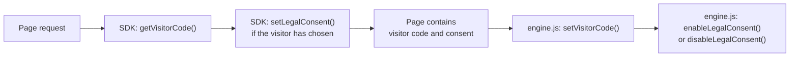
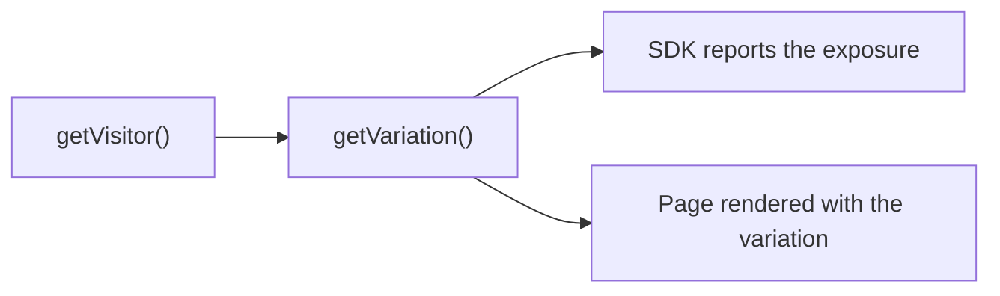
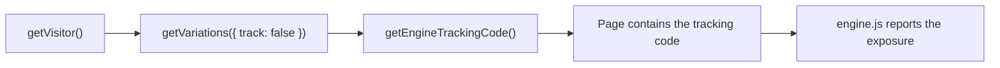

# Kameleoon Hybrid Starter Kit

This project is a minimal example of Kameleoon in hybrid mode: the Node.js SDK on the server together with `engine.js` in the browser.

It has two pages. Both are hybrid: the SDK evaluates the feature flags, `engine.js` is loaded, and the two are synchronized on the visitor code and the legal consent. The pages differ only in who reports the exposure.

| | Server-side tracking | Engine-side tracking |
| --- | --- | --- |
| Page | `/server-tracking` | `/engine-tracking` |
| Exposure reported by | Node.js SDK | `engine.js` |
| SDK tracking | On (default) | Off, `track: false` |
| `getEngineTrackingCode` | Not used | Used |
| `engine.js` receives | Visitor code, consent | Visitor code, consent, engine tracking code |
| SDK method in this example | `getVariation`, one flag | `getVariations`, all flags |

The last row is a choice made for this example, not a rule. Both methods work with both ways of tracking: what makes tracking engine-side is `track: false` plus the engine tracking code.

Choose engine-side tracking when exposures must reach the analytics integrations activated in Kameleoon, such as Google Analytics 4 or Mixpanel, because those run through `engine.js`. Choose server-side tracking when the Node.js SDK should report exposures directly.

Hybrid mode is only compatible with Web SDKs. Mobile SDKs do not support it.

Kameleoon documentation:

- [Hybrid experimentation](https://docs.kameleoon.com/developer-docs/feature-experimentation/get-started/hybrid-experimentation)
- [Node.js SDK](https://docs.kameleoon.com/developer-docs/sdks/web-sdks/nodejs-sdk)
- [Consent management](https://docs.kameleoon.com/developer-docs/privacy-and-compliance/consent-management)

## Run

```bash
cp .env-template .env
```

Fill in `.env`, then:

```bash
pnpm install
```

```bash
pnpm dev
```

Open `http://localhost:3000`. It redirects to `/server-tracking`.

## Configuration

| Variable | Required | Purpose |
| --- | --- | --- |
| `KAMELEOON_SITECODE` | Yes | Site code of the project. Also used in the `engine.js` URL. |
| `KAMELEOON_CLIENT_ID` | Yes | API credentials. |
| `KAMELEOON_CLIENT_SECRET` | Yes | API credentials. |
| `KAMELEOON_FEATURE_KEY` | Yes | Feature flag evaluated on the server-side tracking page. |
| `KAMELEOON_ENVIRONMENT` | No | `production` (default), `staging`, `development`, or a custom key. |
| `KAMELEOON_COOKIE_DOMAIN` | No | Domain of the visitor code cookie, for example `.example.com`. |
| `PORT` | No | Defaults to `3000`. |

A missing required value stops the app at startup.

Set `KAMELEOON_COOKIE_DOMAIN` on a real site. Without it the cookie belongs to one host only, so a visitor can get a different visitor code, and a different variation, on another subdomain. Leave it out on `localhost`, which is not a valid cookie domain for the SDK.

## Code map

| File | Role |
| --- | --- |
| [src/config.ts](src/config.ts) | Reads and checks the environment. |
| [src/kameleoon.ts](src/kameleoon.ts) | Creates the SDK client and initializes it. Nothing else touches credentials. |
| [src/app.ts](src/app.ts) | Web server: waits for the SDK, then serves the two pages. |
| [src/visitor.ts](src/visitor.ts) | Synchronization, server half: gives the visitor code and the consent to the SDK. |
| [src/pages/server-tracking.ts](src/pages/server-tracking.ts) | Server-side tracking page. |
| [src/pages/engine-tracking.ts](src/pages/engine-tracking.ts) | Engine-side tracking page. |
| [src/views/partials/kameleoon.ejs](src/views/partials/kameleoon.ejs) | Synchronization, browser half: gives the same values to `engine.js`, then loads it. |
| [src/views/partials/consent.ejs](src/views/partials/consent.ejs) | Accept / Reject buttons, a stand-in for a consent banner. |

## Visitor synchronization (both pages)

The SDK and `engine.js` run in different places and know nothing about each other. Two values have to be the same on both sides:

- **Visitor code**: who the visitor is. With the same code, a goal that `engine.js` tracks in the browser is attributed to the variation the SDK assigned on the server.
- **Legal consent**: what Kameleoon may do for this visitor. Each side has to be told separately.



Every request starts with `getVisitor` in [visitor.ts](src/visitor.ts):

```ts
const visitorCode = kameleoonClient.getVisitorCode({ request: req, response: res })

if (consent !== "unknown") {
  kameleoonClient.setLegalConsent({ visitorCode, consent: consent === "granted", response: res })
}
```

The page then gives the same two values to `engine.js` in [kameleoon.ejs](src/views/partials/kameleoon.ejs):

```js
window.kameleoonQueue.push({
  level: "IMMEDIATE",
  command: function () { Kameleoon.API.Visitor.setVisitorCode("...") }
})
window.kameleoonQueue.push(function () { Kameleoon.API.Core.enableLegalConsent() })
```

### Visitor code

`getVisitorCode` reads the `kameleoonVisitorCode` cookie or creates a new code, and must be called before any other SDK method. `setVisitorCode` is queued at `IMMEDIATE` level so it runs before `engine.js` does anything else.

The cookie alone is not enough. When the project requires consent, the cookie is not stored until the visitor accepts, so the page passes the code to `engine.js` explicitly. Otherwise `engine.js` would generate its own code and the visitor could get a different variation on the next page.

### Consent

The choice has three states, and the app passes it on to both sides:

| Choice | SDK | `engine.js` |
| --- | --- | --- |
| `granted` | `setLegalConsent(true)` | `enableLegalConsent()` |
| `denied` | `setLegalConsent(false)` | `disableLegalConsent()` |
| `unknown` | Nothing is called | Nothing is called |

The app does not decide what happens without consent. The [consent policy](https://docs.kameleoon.com/user-manual/project-management/consent-management-policy) of the Kameleoon project does. On the SDK side this gives:

| Project policy | Choice | What the SDK does |
| --- | --- | --- |
| Consent not required | Any | Evaluates and tracks. The choice changes nothing. |
| Consent required | `granted` | Evaluates and tracks. |
| Consent required | `unknown` | Evaluates. Tracking is restricted until consent is granted. |
| Consent required | `denied` | Applies **Behavior on opt-out** to experiment rules. Partially block: the visitor gets the default variation. Completely block: `getVariation` throws and `getVariations` leaves the flag out. |

If Reject changes nothing on the pages, the project policy is "Consent not required". For the `engine.js` side, see [Consent management](https://docs.kameleoon.com/developer-docs/privacy-and-compliance/consent-management).

While consent is required and not yet granted, the SDK may not store the visitor code cookie, so the visitor code can change on every request. A visitor should not stay in the `unknown` state for long.

In this example the choice is read from the `kameleoonConsent` cookie. The Accept / Reject buttons write that cookie and reload the page, so both sides receive the choice at the start of the next request. On a real site, read the choice from your consent management platform, and also call `enableLegalConsent()` / `disableLegalConsent()` from its callback so `engine.js` learns the choice without waiting for the next page.

## Server-side tracking



```ts
const { visitorCode, consent } = getVisitor(req, res)
const variation = kameleoonClient.getVariation({ visitorCode, featureKey })
```

`getVariation` tracks by default, so the SDK sends the exposure to Kameleoon. `engine.js` receives only the visitor code and the consent.

`getVariation` throws when the flag cannot be evaluated: the feature key is unknown, the flag is disabled in the environment, or the project blocks experiments for a visitor who denied consent. The page catches that, logs the reason and renders the default experience.

## Engine-side tracking



```ts
const { visitorCode, consent } = getVisitor(req, res)
const variations = kameleoonClient.getVariations({ visitorCode, track: false })
const engineTrackingCode = kameleoonClient.getEngineTrackingCode(visitorCode)
```

`track: false` makes the SDK assign the variations without reporting them, because `engine.js` will. `getEngineTrackingCode` returns JavaScript that tells `engine.js` about those assignments, and `engine.js` reports the exposure.

Three rules:

- Call `getEngineTrackingCode` right after the evaluation, in the same request. It covers every assignment the SDK made for the visitor in the last 5 seconds.
- Print the tracking code before the `engine.js` tag, as [kameleoon.ejs](src/views/partials/kameleoon.ejs) does.
- Evaluate only the flags the page uses. `getVariations` evaluates every flag of the project and `engine.js` reports all of them, which is fine for an example but not for a real page. For a single flag, use `getVariation({ visitorCode, featureKey, track: false })`.

A flag appears in the tracking code only when the visitor matched one of its rules. A flag on its default variation has nothing to report.

## Left out on purpose

- **Conversions.** Use `kameleoonClient.trackConversion` on the server, or the Activation API in the browser.
- **Anti-flicker snippet.** The `engine.js` tag is the [asynchronous tag without anti-flicker](https://docs.kameleoon.com/developer-docs/web-experimentation/implementation-and-deployment/standard-implementation#asynchronous-tag-without-anti-flicker), which Kameleoon recommends for hybrid mode. Add the anti-flicker snippet if `engine.js` also changes what the visitor sees.
